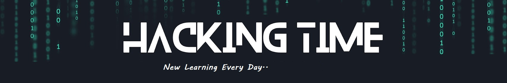

<div align="center">
<h1>ನಮಸ್ಕಾರ, <br> I'm Vinayaka N. Walishettar</h1>

<p><code>SOFTWARE ENGINEER</code> · <code>FULL-STACK DEVELOPER</code> · <code>APP DEVELOPER</code> · <code>OFFENSIVE SECURITY</code></p>

<p>
  <a href="https://github.com/VINAYAKANWALISHETTAR"></a>
  <a href="https://www.nayaka100.in/"></a>
  <a href="https://kavalu-labs.nayaka100.in/"></a>
</p>
    
  

<p></p>

</div>

---

## `root@vnw:~$ whoami`

<table>
<tr>
<td width="28%" align="center" valign="middle">



</td>
<td valign="right">

```text
┌─[ PROFILE ]
│ Name       : Vinayaka N. Walishettar
│ Location   : Hubli, Karnataka, India
│ Education  : B.Tech Computer Science
│ University : VTU Belagavi (2023–2027)
│ CGPA       : 8.6 / 10
│ Internship : Intern — Nantech Solutions
└─[ STATUS ] : Building • Learning • Securing
```

I engineer full-stack applications from concept to deployment, blending robust architecture, cloud infrastructure, security-by-design, and user-first experiences. I explore application and offensive security to build resilient, reliable, and secure software.

</td>
</tr>
</table>

### `root@dev:~$ cat focus.txt`

- **Software Engineering:** Backend systems, API design, clean architecture, and maintainable code.
- **Full-Stack Development:** End-to-end web applications, responsive interfaces, and cross-platform solutions.
- **Cloud & DevOps:** AWS fundamentals, Linux, containerization, CI/CD, and deployment automation.
- **Application Security:** Secure-by-design development, attack-surface analysis, reconnaissance, and vulnerability assessment.
- **Offensive Security:** Ethical hacking, web application penetration testing, exploit analysis, and authorized security labs.


---

## `root@vnw:~$ ./arsenal.sh`

<table>
<tr>
<td width="50%" valign="top">

**`> programming_languages`**


**`> frontend_development`**


**`> mobile_app_development`**


**`> backend_and_api_engineering`**


</td>
<td width="50%" valign="top">

**`> databases_and_backend_services`**


**`> cloud_and_devops`**


**`> offensive_security_toolkit`**

     

**`> security_learning_areas`**

`Web App Security` · `Recon` · `Vulnerability Assessment` · `Penetration Testing` · `Network Security` · `OWASP Top 10`

</td>
</tr>
</table>

<sub>Technologies and security tools represent my toolkit and learning interests; proficiency varies by tool. Security testing is performed only in authorized environments.</sub>


## `root@vnw:~$ ./kavalu --about`

**[Kavalu Labs](https://kavalu-labs.nayaka100.in/)** is my build lab for developing security tools and their supporting platform.

- **Security checks:** TLS configuration, HTTP security headers, cookie attributes, redirects, and information exposure.
- **Findings:** Organizing evidence, potential impact, and remediation guidance, with OWASP Top 10 concepts as a reference.
- **Platform work:** Building across the scanning engine, application workflow, and security reporting experience.

> Authorization first: testing is limited to systems and targets for which permission has been granted.

---

## `root@vnw:~/projects$ ls`

<table>
<tr>
<td width="100%">

### ರಕ್ಷಾ ವ್ಯೂಹ · Raksha-Vyuh
**AI-assisted cybersecurity platform**

A project focused on identifying phishing attempts and online threats, analyzing suspicious activity, and helping route alerts to relevant people, including guardians.

</td>
</tr>
<tr>
<td>

### ಮಾತಕ್ಷರ · Mattakshara
**Voice-first conversational intelligence**

A work-in-progress assistant concept for speaking or uploading audio, asking questions in a preferred language, and receiving useful responses or reports.

</td>
</tr>
<tr>
<td>

### ಜಾಣತನ · Jaanatana
**Intelligent digital solutions**

A work-in-progress project exploring practical problem-solving through a thoughtful, useful digital experience.

</td>
</tr>
</table>

---

## `root@vnw:~$ cat achievements.log`

| Event | Result |
|---|---|
| Smart India Hackathon | Winner — National |
| LEAP Hackathon | 2nd Runner-up |
| Hack2Future | Top 10 among 60+ teams |
| MAKE FOR BELAGAVI | Certificate of Achievement |

---

## `root@vnw:~$ ./connect --secure`

<div align="center">

<!-- <a href="mailto:vinayakanw@gmail.com"></a> -->
<a href="https://www.linkedin.com/in/vinayaka-n-walishettar/"></a>
<a href="https://github.com/VINAYAKANWALISHETTAR"></a>
<a href="https://www.nayaka100.in/"></a>
<a href="https://www.instagram.com/yenri_mediaa_100/"></a>
<a href="https://www.reddit.com/user/vinayakanw/"></a>


```text
┌──(vinayaka㉿kali)-[~]
└─$ echo "Build it. Break it. Secure it."
```

</div>
